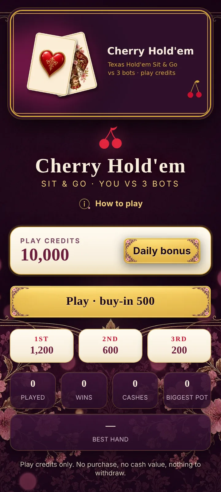
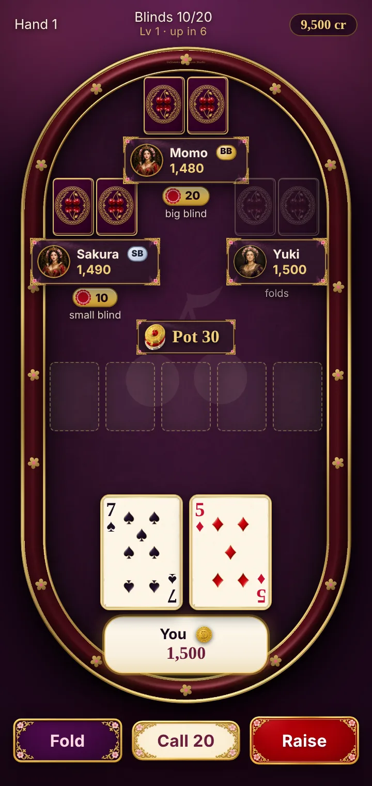
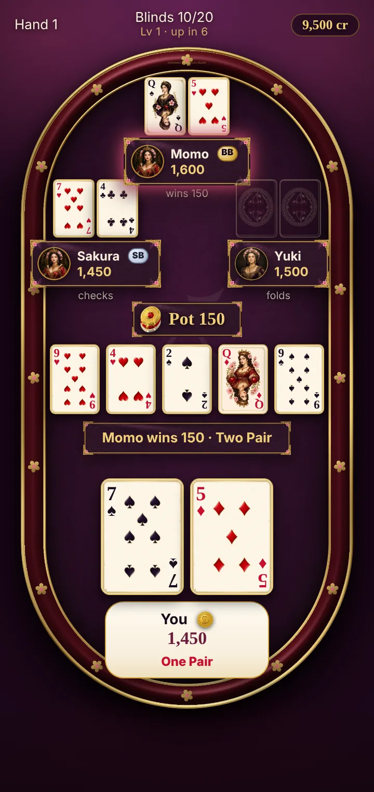

# Handoff — cherry-holdem — claude-code — 2026-11-12 16:50 ET

**Session goal:** Close-out order P2 — gap list + full UI kit (cherry-cards @ `778d58f`) wired into the poker app.
**Status:** DONE (P2) · P4 waits on P1 name · D5 next
**Repo / branch:** 0xSneaks/cherry-holdem @ `claude/cherry-holdem-portal-deploy-mye3cp` · **Last commit:** `a03dbdb` (pushed → Preview only)

## Did
- `8448f36` table polish: fold needs a second tap when check is free (2.5 s), compact raise panel (presets + slider + Back), blinds HUD shows "Lv N · up in K" — VERIFIED (screenshot: one tap leaves you in the hand)
- `06a0584` bots act faster (300 ms) once you have folded/busted — VERIFIED
- bot raises rounded to small-blind steps (60, not 49) + test that fails without the fix — VERIFIED
- `a03dbdb` UI kit wired: 23 webp in `public/ui/` (buttons fold/checkcall/raise/play with pressed + disabled art, seat/pot/toast/dialog panels via CSS border-image, 4 avatars, turn ring, dealer coin, back + info icons, chip stack, lobby art). "How to play" dialog. Fixed "You wins" → "You win" — VERIFIED (screens below)

## State (evidence)
- Tests: `npx vitest run` 51/51 pass · `tsc --noEmit` clean — VERIFIED
- Build: vite dev, Playwright 360×760 @2x, 0 console errors — VERIFIED
- Deployed: branch push → Vercel Preview (no Production) — INFERENCE (auto-deploy on push, not re-checked this run)

## 360 px screenshots
| Lobby | Table | Showdown |
|---|---|---|
|  |  |  |

## Gap list → `projects/cherry-holdem.md` (§ Lobby/table gap list)

## Next (start here)
1. P4: Sneaks posts the new name (P1) → claude-code swaps it everywhere; keep CU/IR/KP + SD/UA blocks, Terms/Privacy, 18+.
2. D5: ⚠️ money-path review of cherry-launch-room (read-only) + independent Opus cross-check.
3. P3 (grok-bot) number cards still pending — tables still show template pips.

## Don't
- No SOL / buy-ins / purchases / cash-out. SOL_ENABLED=false. No wallet button or signMessage.
- No Production without Sneaks's "PROD YES".
